<div align="center">

<picture>
  <source media="(prefers-color-scheme: dark)" srcset=".github/assets/banner-dark.svg">
  
</picture>

**Live status on the lock screen from one typed state model.**<br>
Drive ActivityKit Live Activities, the Dynamic Island and Android ongoing live notifications from PHP.

[](https://packagist.org/packages/pushinbr/pam-native-live-activities)
[](https://github.com/push-in/pam-native-live-activities/releases/latest)

[](https://github.com/push-in/pam-native-live-activities/actions/workflows/ci.yml)
[](LICENSE)

[Install](#install) · [Quick example](#quick-example) · [Platforms](#platform-support) · [Permissions](#requirements) · [Reference](docs/reference.md) · [Issues](https://github.com/push-in/pam-native-live-activities/issues)

</div>

<a id="install"></a>
## <picture></picture> Install

Inside a PAM Native project, add only this capability:

```sh
pam composer require pushinbr/pam-native-live-activities
pam doctor --fix
```

The generated iOS project includes the ActivityKit extension and the Android build includes the ongoing-notification implementation. New to PAM? Create a project with `pam init my-app --template native` (see the [PAM Native overview](https://push-in.github.io/pam-docs/native/overview/)).

<a id="quick-example"></a>
## <picture></picture> Quick example

```php
use Pam\Native\LiveActivities\LiveActivities;
use Pam\Native\LiveActivities\LiveActivityContent;

$activities = new LiveActivities();
$content = new LiveActivityContent('Order on the way', 'Preparing', 0.15, 'myapp://orders/42');

$activities->start('order-42', $content, function (?string $identifier, ?string $error) use ($activities): void {
    if ($identifier === null) {
        return;
    }

    $activities->update(
        $identifier,
        new LiveActivityContent('Order on the way', 'Courier assigned', 0.45),
        static fn (?string $updated, ?string $error) => null,
    );
}, pushEnabled: true);
```

Supports start, update, end, deep links, progress and ActivityKit push tokens returned by `active()`. Store the returned identifier for later updates and termination. Use `active()` after process restart to reconcile the operating-system state.

<a id="platform-support"></a>
## <picture></picture> Platform support

| Platform | Support | Notes |
| --- | --- | --- |
| Android | API 26+ | Ongoing live notification |
| iOS | 16.2+ | ActivityKit, WidgetKit, SwiftUI; Live Activity extension `PamLiveActivities`, Dynamic Island |
| PAM Native | 0.8.0 to < 2.0.0 | From `pam-native.plugin.json`; PHP 8.5+ |

<a id="requirements"></a>
## <picture></picture> Permissions and requirements

| Platform | Declared by the plugin |
| --- | --- |
| Android | `android.permission.POST_NOTIFICATIONS` (request it at runtime on Android 13+) |
| iOS | ActivityKit Live Activity extension and `ios/AppInfo.plist` |

Remote ActivityKit updates require APNs token-based delivery from your server. Avoid high-frequency updates unless the displayed value materially changes.

<a id="what-you-can-build"></a>
## <picture></picture> What you can build

- Sports scores and live events
- Delivery, trip, and queue progress
- Timers, workouts, and session status

| | |
| --- | --- |
| **Native path** | ActivityKit · Android ongoing notifications |
| **Application model** | Composer package + generated native integration |
| **Design rule** | Independent module; no feed, vertical, or application template bundled |

<a id="production-checklist"></a>
## <picture></picture> Production checklist

- Persist returned identifiers and reconcile them with `active()` after restart.
- Send remote ActivityKit updates through authenticated APNs token delivery.
- Update only when displayed information materially changes.
- Run `pam doctor`, `pam test`, and a signed release build on every supported platform.
- Exercise denial, cancellation, backgrounding, process restart, and offline behavior before release.

Platform SDKs, credentials, entitlements, physical hardware, and store configuration remain application responsibilities. Report security vulnerabilities through GitHub private vulnerability reporting, not a public issue.

<a id="docs"></a>
## <picture></picture> Docs

- [Reference](docs/reference.md): install details, API guide, troubleshooting
- [PAM Native overview](https://push-in.github.io/pam-docs/native/overview/)
- [Plugin and native capability model](https://push-in.github.io/pam-docs/native/plugins/)
- [Changelog](CHANGELOG.md)
- [Report an issue](https://github.com/push-in/pam-native-live-activities/issues)

<a id="pam-ecosystem"></a>
## <picture></picture> Part of the PAM ecosystem

<p align="center"><picture>
  <source media="(prefers-color-scheme: dark)" srcset=".github/assets/pam-wordmark-dark.svg">
  
</picture></p>

PAM runs PHP natively on servers, desktops and phones. This repository is one piece of it.

| [**PAM**](https://github.com/push-in/pam) | [**PAM Desktop**](https://github.com/push-in/pam-desktop) | [**PAM Native**](https://github.com/push-in/pam-native) | [**Ecosystem**](https://github.com/push-in/pam#ecosystem) |
| --- | --- | --- | --- |
| the runtime and CLI | native desktop apps in PHP | native Android and iOS apps in PHP | every official package and plugin |

<sub>Docs: [push-in.github.io/pam-docs](https://push-in.github.io/pam-docs/introduction/) · [Issues](https://github.com/push-in/pam-native-live-activities/issues)</sub>

<p align="center"><sub><a href="LICENSE">Apache License 2.0</a> · Made in Brazil by Pushin</sub></p>
